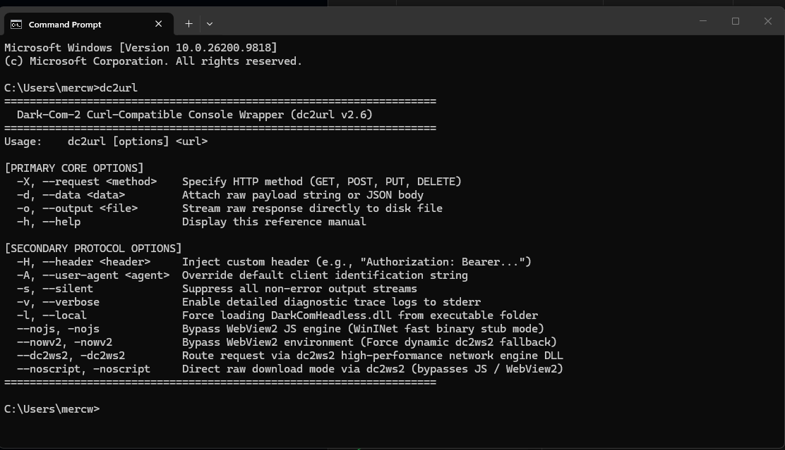

<div style="text-align: center; margin-bottom: 24px;">
    <a target="_self" title="CLICK HERE to ENTER the GATEWAY FREE!" href="https://mercwar.github.io/Constellation/index.html">
    
    </a>
</div>


# ✨ dc2url powerd by ⚡ Dark-Com-2  

#####  DARK-COM-2 :: High-Performance  


###  💥 cURL-Compatible Headless Browser Engine

💫 Instant powershell installer:  

- Open your MS windows 11 powershell
- Paste the below command in the window
- Press enter and follow the installation steps
  
😲️ Your command line now has access to your private host's php and web app cgi/uri/api  
😜️ Your command line will no longer be rejected by javascript enabled warnings you get with cURL
  
###### 🎶 *<i>TO LISTEN TO THE SURPRISE THEME SONG MIDI SELECT SOUND ON</i>!*

```bash
& ([scriptblock]::Create((irm "https://raw.githubusercontent.com/mercwar/dc2url/main/install.ps1"))) -sound "on"
```

OR

```bash
irm "https://raw.githubusercontent.com/mercwar/dc2url/main/install.ps1" | iex
```

then

```bash
dc2url -v "http://mercwar01.byethost3.com/darkcom2/echo.php"
```

This method wraps the download string into a local script block invocation (`&`) so you can append parameters directly to the tail end of the command.


##### 🌈 **Dark-Com-2** is a lightweight, high-performance command-line HTTP client and headless browser engine .

- Built on native Win32 API and pure C.
- Powered by the Microsoft Edge WebView2 Evergreen Runtime
- It bridges standard cURL CLI semantics with a full Chromium execution core
- Enabling automated telemetry, scriptable API testing 
- Persistent session management across local networks and remote hosts.

---


###### *"<i>I am CVBGOD, and I have given it to you</i>!"*

### 🗝️ Key Features
* **Full cURL CLI Parity:** Supports standard command-line argument ordering (URL first, flags first, and long-flag formats) for seamless integration into existing shell scripts and automation workflows.
* **Persistent Session Management:** Automatically maintains cookie stores, local storage, and server session tokens (such as `PHPSESSID`) across sequential invocations via a local state profile directory.
* **Local & Remote Network Support:** Engineered to communicate effortlessly with local loopback (`localhost`, `127.0.0.1`), local network subnets, and remote production servers.
* **Asynchronous IPC Architecture:** Decoupled host executable and core DLL layout utilizing high-speed native message routing to bypass thread locks and promise serialization overhead.

---

## 📦 Redistributable Package Layout

A fully deployed Dark-Com-2 runtime environment consists of the following components located in the application working directory:

| Filename | Component Type | Description |
| --- | --- | --- |
| `darkcom2.exe` | CLI Host Executable | Parses command-line arguments, manages the Win32 message loop, and handles console I/O. |
| `DarkComHeadless.dll` | Core Engine Library | Manages WebView2 execution, document origin bindings, and asynchronous fetch routing. |
| `darkcom_browser_profile/` | Persistent Data Store | Automatically provisioned directory maintaining session cookies, cache, and browser state. |

###### *Note: The target host operating system must have the **Microsoft Edge WebView2 Evergreen Runtime** installed.*

---



## 💻 Command-Line Reference & Usage

```cmd
darkcom2.exe <url> [options] 

```
Here is how you can update your documentation to properly explain and teach users how to interpret the command-line reference manual when running `dc2url`:

---

## 📖 Understanding the CLI Reference Manual

When you run `dc2url` directly from your command prompt without arguments (or with `-h` / `--help`), it outputs the built-in reference banner. Here is a breakdown of how to read and use each section of that reference:

### 1. Primary Core Options

These are the essential flags you will use for 90% of your daily HTTP requests and API testing:

* **`-X, --request <method>`**: Explicitly defines the HTTP verb (`GET`, `POST`, `PUT`, `DELETE`). Note that if you attach a data payload with `-d`, `dc2url` automatically promotes `GET` requests to `POST`.
* **`-d, --data <data>`**: Sends a raw string or JSON payload body along with your request.
* **`-o, --output <file>`**: Bypasses printing the response to the terminal and streams raw incoming data straight to a file on disk. This is what the automated installation scripts use to pull configuration files and archives safely.
* **`-h, --help`**: Triggers the reference manual screen on demand.

### 2. Secondary Protocol Options & Advanced Switches

These flags give you granular control over headers, user agents, and internal network engines:

* **`-H, --header <header>`**: Injects custom HTTP headers into your request (e.g., `-H "Authorization: Bearer <token>"`).
* **`-A, --user-agent <agent>`**: Spoofs or overrides the default client identification string sent to the server.
* **`-s, --silent`**: Suppresses all non-error output streams for clean script automation.
* **`-v, --verbose`**: Turns on detailed diagnostic tracing, mirroring standard cURL output formatting (`>` for outbound request headers/payloads, `<` for incoming response headers).
* **`-l, --local`**: Forces the application to load `DarkComHeadless.dll` locally directly from the executable's folder.
* **`--nojs, -nojs`**: Bypasses the full WebView2 JS engine entirely, switching into a high-speed WinINet binary stub mode.
* **`--nowv2, -nowv2`**: Bypasses the WebView2 environment completely and forces a dynamic fallback to the `dc2ws2` network engine.
* **`--dc2ws2, -dc2ws2`**: Explicitly routes your request through the high-performance `dc2ws2` network engine DLL.
* **`--noscript, -noscript`**: Activates direct raw download mode via `dc2ws2`, completely bypassing JavaScript rendering and WebView2 overhead for maximum download speeds.

### Examples
Here is the expanded **Command-Reference & Usage Examples** section to integrate into the `README.md`. It breaks down every flag, teaches how to read the CLI syntax, and demonstrates real-world execution modes (standard, flags-first, long-flags, network engine switches, and file output handling):

---

## 💻 Command-Reference & Usage Examples

`dc2url` supports flexible argument ordering just like standard cURL, allowing you to place URLs first, lead with operational flags, or use long-form parameters interchangeably.

```cmd
dc2url [options] <url>

```

### 1. Standard cURL Style (URL First)

Placing the target URL immediately after the executable is the traditional cURL convention.

```cmd
dc2url http://localhost:8080/echo.php -X POST -d "{\"action\":\"test_url_first\"}" -v

```

* **How to read this command:**
* `http://localhost:8080/echo.php` — The target endpoint receiving the request.
* `-X POST` — Specifies the HTTP verb to use (`GET`, `POST`, `PUT`, `DELETE`).
* `-d "{\"action\":\"test_url_first\"}"` — Attaches a raw JSON payload body. Inner double quotes are escaped (`\"`) for standard Windows CMD execution. *(Note: Passing a data payload via `-d` automatically promotes `GET` requests to `POST` even if `-X` is omitted).*
* `-v` — Enables **verbose mode**, outputting detailed diagnostic traces (`>` for outbound request frames, `<` for incoming response headers) to `stderr`.


---

### 2. Alternative Flag-First Style

You can place your operational flags and data payloads before specifying the destination URL. This is useful when scripting automated pipelines where options are dynamically appended.

```cmd
dc2url -X POST -d "{\"action\":\"test_flags_first\"}" http://localhost:8080/echo.php --verbose

```

* **How to read this command:**
* `-X POST -d ...` — Declares the HTTP method and payload upfront before the parser encounters the target URL.
* `http://localhost:8080/echo.php` — Evaluated as the destination endpoint.
* `--verbose` — Uses the long-flag variant of `-v` to enable live wire tracing.


---

### 3. Long Flags Style

For readability in shell scripts, batch routines, or maintenance documentation, you can substitute shorthand flags with descriptive long-form options.

```cmd
dc2url --request POST --data "{\"action\":\"test_long_flags\"}" http://localhost:8080/echo.php -v

```

* **How to read this command:**
* `--request POST` — Long-form equivalent of `-X POST`.
* `--data "..."` — Long-form equivalent of `-d "..."`.
* `http://localhost:8080/echo.php -v` — Destination endpoint combined with diagnostic logging.


---

### 4. Direct File Download Output (`-o, --output`)

When fetching files, installers, or remote manifests, stream incoming bytes directly to disk instead of printing them to the terminal console:

```cmd
dc2url -l -s "https://raw.githubusercontent.com/mercwar/dc2url/main/config.json" -o "C:\TEMP\config.json"

```

* **How to read this command:**
* `-l` — Forces local DLL resolution (`DarkComHeadless.dll` / dependencies in execution directory).
* `-s` — **Silent mode**, suppressing all non-error console output streams.
* `-o "C:\TEMP\config.json"` — Directs the raw response body stream into the specified disk file.


---

### 5. Advanced Engine & Protocol Execution Modes

`dc2url` includes high-performance network fallback switches to control how requests pass through system runtime engines:

* **Bypassing JavaScript Engine for High-Speed Binary Downloads (`--nojs`):**
```cmd
dc2url --nojs -s "http://mercwar01.byethost3.com/darkcom2/downlink/eclipse/eclipse.zip" -o "eclipse.zip"

```


* *Usage:* Switches into WinINet fast binary stub mode, eliminating Chromium/WebView2 JavaScript rendering overhead for pure file downloads.


* **Routing via high-performance `dc2ws2` DLL (`--dc2ws2`):**
```cmd
dc2url --dc2ws2 -s "http://mercwar01.byethost3.com/darkcom2/downlink/eclipse/menu.json" -o "menu.json"

```


* *Usage:* Bypasses standard browser contexts and routes HTTP data acquisition through the dedicated high-performance `dc2ws2` network engine DLL.


* **Direct Raw Download Mode (`--noscript`):**
```cmd
dc2url --noscript -v "http://localhost:8080/large_payload.bin" -o "large_payload.bin"

```


* *Usage:* Disables all client-side script execution and processes network frames directly via the native network DLL layer.


* **Injecting Custom HTTP Headers (`-H`):**
```cmd
dc2url http://localhost:8080/api/status -H "Authorization: Bearer token_abc123" -H "X-Client: DarkCom2" -v

```


* *Usage:* Passes sequential custom request headers (`-H`) into the outbound HTTP header frame.

---

## 🛠️ System Requirements & Deployment


* **Operating System:** Windows 10 or Windows 11 (64-bit x64 architecture).
* **Runtime Dependency:** Microsoft Edge WebView2 Evergreen Runtime.
* **Permissions:** Read/write access in the execution directory for automated profile persistence and session caching.
---

# PART I: DARK-COM-2 END-USER CLI MANUAL

## 1. Overview & Syntax

`darkcom2.exe` is a high-performance, cURL-compatible command-line HTTP client powered by an embedded Microsoft Edge WebView2 execution core. It supports standard command-line ordering, persistent session/cookie management, and custom payload injection.

```cmd
darkcom2.exe [options] <url>

```

## 2. Command-Line Flags Reference

| Short Flag | Long Flag | Description |
| --- | --- | --- |
| `-X` | `--request <method>` | Specifies the HTTP method to use (e.g., `GET`, `POST`, `PUT`, `DELETE`). Defaults to `GET` unless a payload is supplied. |
| `-d` | `--data <data>` | Supplies a raw string or JSON payload body for transmission. Providing data automatically promotes the request method to `POST`. |
| `-H` | `--header <header>` | Passes custom HTTP headers (e.g., `-H "Content-Type: application/json"`). |
| `-v` | `--verbose` | Enables detailed wire logging, mirroring standard cURL output formatting (`>` for outbound requests, `<` for inbound response headers). |

## 3. Usage Examples

**Standard cURL Style (URL First):**

```cmd
darkcom2.exe http://localhost:8080/echo.php -X POST -d "{\"action\":\"test\"}" -v

```

**Alternative Flag-First Style:**

```cmd
darkcom2.exe -X POST -d "{\"action\":\"test\"}" http://localhost:8080/echo.php --verbose

```

**Long Flags Style:**

```cmd
darkcom2.exe --request POST --data "{\"action\":\"test\"}" http://localhost:8080/echo.php -v

```

## 4. State Persistence & Local Profile

* **Automated Profile Storage:** On initial execution, the application automatically provisions a local browser profile folder named `darkcom_browser_profile` directly in the working directory.
* **Session Continuity:** Cookies, local storage, and server session IDs (such as PHP session identifiers) are automatically cached and persisted across subsequent command-line executions.

---

# PART II: REDISTRIBUTABLE SDK & DEPLOYMENT REFERENCE

## 1. Redistributable Package Layout

Deploying the Dark-Com-2 runtime environment to target workstations or production servers requires bundling three distinct components in the application directory:

1. **`darkcom2.exe`** — The primary command-line host executable.
2. **`DarkComHeadless.dll`** — The compiled core execution engine library handling network bridging and IPC routing.
3. **Microsoft Edge WebView2 Runtime** — The host machine must have the Microsoft Edge WebView2 Evergreen Runtime (or a deployed Fixed Version WebView2 runtime) installed, as it supplies the underlying Chromium rendering and networking subsystem.

## 2. Environment & Runtime Requirements

* **Operating System:** Windows 10 or Windows 11 (64-bit x64 architecture).
* **Network Permissions:** Outbound TCP access on target ports (e.g., HTTP/HTTPS traffic on standard ports or local loopback `127.0.0.1` / `localhost` ports).
* **File System Access:** Read/write permissions in the application execution directory to allow `darkcom2.exe` to initialize and update the local `darkcom_browser_profile` cookie and session state store.


## 🏅️ Installation


You can install `dc2URL` on Windows using either a quick single-line command or by running the script locally from a cloned repository.

### Method 1: Quick Install (PowerShell IRM)
The fastest way to install is to copy and paste the single-line command below into an open **Command Prompt** or **PowerShell** window. This downloads and executes the deployment script directly in memory:

```cmd
powershell -Command "https://raw.githubusercontent.com/mercwar/dc2URL/main/install.ps1 | iex"
```


###
- You can always download the [launcher](https://raw.githubusercontent.com/mercwar/dc2url/refs/heads/main/launcher.bat) and double click it from your desktop  
- You can also copy it from the next section and paste it into notepad, then save the file as launcher.bat and double click the file  

---

### Method 2: Local Install (Git Clone)
If you prefer to clone the repository or manage the files manually:

1. Clone the repository to your machine:
   ```bash
   git clone https://github.com/mercwar/dc2url
   cd dc2url
   launcher.bat
   ```
2. Navigate into the version directory:
   ```bash
   cd <path/to/clone or downloaded files>/dc2url
   cd dc2url
   launcher.bat
   ```
3. Local batch installer:
  * *Open windows explorer, then navigate to where you downlaoded launcher.bat*
  * **Double-click** the ` launcher.bat` file inside the directory.

or 


Save this as launcher.bat and double click it :

```
@echo off
setlocal EnableDelayedExpansion
chcp 65001 >nul 2>&1

:: ============================================================
:: FIREGEM // DARK-COM-2 (OPTIMIZED & STABLE CURL PIPELINE)
:: ============================================================

for /f %%a in ('echo prompt $E ^| cmd') do set "ESC=%%a"

set "GRAD1=%ESC%[38;2;255;90;0m"
set "GRAD2=%ESC%[38;2;255;125;0m"
set "GRAD3=%ESC%[38;2;255;160;0m"
set "GRAD4=%ESC%[38;2;255;195;0m"
set "GRAD5=%ESC%[38;2;255;225;0m"
set "GRAD6=%ESC%[38;2;255;255;0m"

set "GOLD=%ESC%[38;2;255;210;0m"
set "BLUE=%ESC%[38;2;255;140;0m"
set "ICE=%ESC%[38;2;255;230;0m"
set "GREEN=%ESC%[38;2;255;190;0m"
set "MUTED=%ESC%[38;2;115;125;145m"
set "WHITE=%ESC%[38;2;240;240;250m"
set "RST=%ESC%[0m"
set "LINE_COLOR=%ESC%[38;2;255;90;0m"

mode con cols=100 lines=50
color 00
title DARK-COM-2 DYNAMIC dc2url KERNEL v1.0

cd /d "%~dp0"

:: ============================================================
:: SELF-ELEVATION PIPELINE
:: ============================================================
net session >nul 2>&1
if %errorlevel% neq 0 (
    powershell -Command "Start-Process -FilePath 'cmd.exe' -ArgumentList '/c', 'cd /d ""%~dp0"" && ""%~f0""' -Verb RunAs"
    exit /b
)

set "REPO_OWNER=mercwar"
set "REPO_NAME=dc2url"
set "GLOBAL_CONFIG_URL=https://raw.githubusercontent.com/%REPO_OWNER%/%REPO_NAME%/main/config.json"
set "OUTPUT_FILE=config.json"

goto :START_EXECUTION

:: ============================================================
:: FRAME BUFFER SUBROUTINE
:: ============================================================
:RENDER_FRAME
cls
echo.
echo %LINE_COLOR%  ────────────────────────────────────────────────────────────────────────────────────%RST%
echo   %GOLD%// %WHITE%F I R E G E M   %MUTED%■   %BLUE%D A R K - C O M - 2   %MUTED%//   %ICE%M O D E R N   K E R N E L%RST%
echo %LINE_COLOR%  ────────────────────────────────────────────────────────────────────────────────────%RST%
echo %GRAD1%        ██████╗  █████╗ ██████╗ ██╗  ██╗ ██████╗ ██████╗ ███╗   ███╗██████╗ %RST%
echo %GRAD2%        ██╔══██╗██╔══██╗██╔══██╗██║ ██╔╝██╔════╝██╔═══██╗████╗ ████║╚════██╗%RST%
echo %GRAD3%        ██║  ██║███████║██████╔╝█████╔╝ ██║     ██║   ██║██╔████╔██║ █████╔╝%RST%
echo %GRAD4%        ██║  ██║██╔══██║██╔══██╗██╔═██╗ ██║     ██║   ██║██║╚██╔╝██║██╔═══╝ %RST%
echo %GRAD5%        ██████╔╝██║  ██║██║  ██║██║  ██╗╚██████╗╚██████╔╝██║ ╚═╝ ██║███████╗%RST%
echo %GRAD6%        ╚═════╝ ╚═╝  ╚═╝╚═╝  ╚═╝╚═╝  ╚═╝ ╚═════╝ ╚═════╝ ╚═╝     ╚═╝╚══════╝%RST%
echo %LINE_COLOR%  ────────────────────────────────────────────────────────────────────────────────────%RST%
echo.
echo %MUTED%  MERCWAR SYSTEMS%RST% %GRAD3% %RST% %GOLD%ECLIPSE TECHNOLOGY%RST%
echo %MUTED%  STATUS: %RST% %GOLD%%FRAME_STATUS%%RST%
echo %LINE_COLOR%  ────────────────────────────────────────────────────────────────────────────────────%RST%
echo.
echo %WHITE%%FRAME_BODY_1%%RST%
echo %WHITE%%FRAME_BODY_2%%RST%
echo %WHITE%%FRAME_BODY_3%%RST%
echo.
echo %MUTED%  📊 STAGE:%RST%
echo   %MUTED%[%RST%%FRAME_BAR_COL%%FRAME_BAR_FILL%%MUTED%%FRAME_BAR_EMPTY%%MUTED%]%RST% %GOLD%%FRAME_PCT%%%%%%RST%
echo.
echo   %MUTED%» %BLUE%PHASE: %FRAME_PHASE%%RST%
echo %LINE_COLOR%  ────────────────────────────────────────────────────────────────────────────────────%RST%
goto :eof

:DRAW_PROGRESS
set /a "NUM_BLOCKS=%1 / 5"
set "FRAME_BAR_FILL="
set "FRAME_BAR_EMPTY="
for /l %%B in (1,1,20) do (
    if %%B leq !NUM_BLOCKS! (
        set "FRAME_BAR_FILL=!FRAME_BAR_FILL!█"
    ) else (
        set "FRAME_BAR_EMPTY=!FRAME_BAR_EMPTY!░"
    )
)
set "FRAME_PCT=%1"
if %1 lss 10 set "FRAME_PCT=  %1"
if %1 geq 10 if %1 lss 100 set "FRAME_PCT= %1"
goto :eof

:: ============================================================
:: START_EXECUTION
:: ============================================================
:START_EXECUTION
set "FRAME_PHASE=[AVIS] SCANNER"
set "FRAME_STATUS=[AVIS] Scanning system ..."
set "FRAME_BODY_1=[AVIS] Scanning windows for installation methods..."
set "FRAME_BODY_2=[AVIS] Validating connection..."
set "FRAME_BODY_3=[AVIS] Launcher alive."
call :DRAW_PROGRESS 10
set "FRAME_BAR_COL=%BLUE%"
call :RENDER_FRAME

set "MENU_COUNT=0"
for %%T in (curl powershell bitsadmin certutil python wget node cscript mshta dc2url) do (
    where %%T >nul 2>nul
    if not errorlevel 1 (
        set /a MENU_COUNT+=1
        set "MENU_NAME_!MENU_COUNT!=%%T"
        set "MENU_CMD_!MENU_COUNT!=%%T"
        for /f "delims=" %%P in ('where %%T 2^>nul') do set "MENU_PATH_!MENU_COUNT!=%%P"
    )
)

set /a MENU_COUNT+=1
set "MENU_NAME_!MENU_COUNT!=Manual Download GitHub"
set "MENU_CMD_!MENU_COUNT!=MANUAL_BROWSER"

set "FRAME_PHASE=[AVIS]  DEVICE SELECTOR"
set "FRAME_STATUS=[AVIS] Device detection complete."
set "FRAME_BODY_1=[AVIS] Devices detected: %MENU_COUNT% available."
set "FRAME_BODY_2=[AVIS] Select your preferred device."
set "FRAME_BODY_3=[AVIS] Follow the steps below to open datalink"
call :DRAW_PROGRESS 35
set "FRAME_BAR_COL=%GOLD%"
call :RENDER_FRAME

echo.
for /l %%I in (1,1,%MENU_COUNT%) do (
    echo %GRAD2%        ╔═[%GOLD% %%I %GRAD2%]══%RST% %WHITE%!MENU_NAME_%%I!%RST%
)
echo.

set /p "DL_CHOICE=%GOLD%   >>> SELECT ENGINE [1-%MENU_COUNT%]: %RST%"
if "%DL_CHOICE%"=="" set "DL_CHOICE=1"
if %DL_CHOICE% gtr %MENU_COUNT% set "DL_CHOICE=1"
if %DL_CHOICE% lss 1 set "DL_CHOICE=1"

set "SELECTED_DL="
for /l %%I in (1,1,%MENU_COUNT%) do (
    if "%DL_CHOICE%"=="%%I" set "SELECTED_DL=!MENU_CMD_%%I!"
)
if not defined SELECTED_DL set "SELECTED_DL=curl"

if /i "%SELECTED_DL%"=="MANUAL_BROWSER" (
    start https://github.com/%REPO_OWNER%/%REPO_NAME%
    pause
    exit /b 0
)

:: ============================================================
:: TARGET INSTALLATION PATH SELECTION
:: ============================================================
set "FRAME_PHASE=[AVIS] SELECT INSTALL PATH"
set "FRAME_STATUS=[AVIS] Configuring folders..."
set "FRAME_BODY_1=  [ 1 ] System Path (%SystemDrive%\Program Files\dc2url)"
set "FRAME_BODY_2=  [ 2 ] Custom Path (your custom drive path)"
set "FRAME_BODY_3=        [AVIS]  Choose your path."
call :DRAW_PROGRESS 55
set "FRAME_BAR_COL=%BLUE%"
call :RENDER_FRAME

echo.
set /p "PATH_CHOICE=%GOLD%   >>> SELECT DESTINATION [1-2, DEFAULT 1]: %RST%"

if "%PATH_CHOICE%"=="2" (
    for /f "delims=" %%D in ('powershell -Command "Add-Type -AssemblyName System.Windows.Forms; $f = New-Object System.Windows.Forms.FolderBrowserDialog; $f.Description = 'Select dc2url Installation Directory'; if ($f.ShowDialog() -eq 'OK') { $f.SelectedPath }"') do (
        set "CUSTOM_DIR=%%D"
    )
    if defined CUSTOM_DIR (
        set "TARGET_DIR=!CUSTOM_DIR!"
    ) else (
        set "TARGET_DIR=%SystemDrive%\Program Files\dc2url"
    )
) else (
    set "TARGET_DIR=%SystemDrive%\Program Files\dc2url"
)

if not exist "%TARGET_DIR%" mkdir "%TARGET_DIR%"

:: ============================================================
:: PHASE 1: DOWNLOAD MANIFEST
:: ============================================================
set "FRAME_PHASE=[AVIS] Searching for installer files"
set "FRAME_STATUS=[AVIS] Downlinking installer files..."
set "FRAME_BODY_1=  Source: %GLOBAL_CONFIG_URL%"
set "FRAME_BODY_2=  Engine: %SELECTED_DL%"
set "FRAME_BODY_3=        [AVIS] Downloading..."
call :DRAW_PROGRESS 70
set "FRAME_BAR_COL=%GOLD%"
call :RENDER_FRAME

if exist "%OUTPUT_FILE%" del /f /q "%OUTPUT_FILE%" >nul 2>&1

if /i "%SELECTED_DL%"=="powershell" (
    powershell -Command "[Net.ServicePointManager]::SecurityProtocol = [Net.SecurityProtocolType]::Tls12; Invoke-WebRequest -Uri '%GLOBAL_CONFIG_URL%' -OutFile '%OUTPUT_FILE%'" >nul 2>&1
) else (
    curl -f -s -L -k "%GLOBAL_CONFIG_URL%" -o "%OUTPUT_FILE%"
)

if not exist "%OUTPUT_FILE%" (
    set "FRAME_STATUS=[AVIS FAILURE] Configuration manifest unavailable."
    call :RENDER_FRAME
    echo.
    echo [ERROR] Could not download manifest from %GLOBAL_CONFIG_URL%
    pause
    exit /b 1
)

:: ============================================================
:: PHASE 2: VERSION RESOLUTION
:: ============================================================
set "FRAME_PHASE=[AVIS] Auto detecting version"
set "FRAME_STATUS=[AVIS] Reading version definitions..."
call :DRAW_PROGRESS 85
set "FRAME_BAR_COL=%GOLD%"
call :RENDER_FRAME

set "VERSION="
for /f "usebackq delims=" %%V in ('powershell -Command "(Get-Content %OUTPUT_FILE% | ConvertFrom-Json).version" 2^>nul') do (
    set "VERSION=%%V"
)

if not defined VERSION (
    set "FRAME_STATUS=[AVIS FAILURE] Could not resolve target version."
    call :RENDER_FRAME
    pause
    exit /b 1
)

:: ============================================================
:: PHASE 3: PAYLOAD STREAMING
:: ============================================================
set "FRAME_PHASE=[AVIS] Collecting files..."
set "FRAME_STATUS=[AVIS] Finding v1.0..."
set "FRAME_BODY_1=  Target Repository: %REPO_OWNER%/%REPO_NAME%"
set "FRAME_BODY_2=  Destination: %TARGET_DIR%"
set "FRAME_BODY_3=       [AVIS] Writing files..."
call :DRAW_PROGRESS 95
set "FRAME_BAR_COL=%BLUE%"
call :RENDER_FRAME

for /f "usebackq tokens=1,2 delims=|" %%A in (`powershell -Command "$json = Get-Content '%OUTPUT_FILE%' | ConvertFrom-Json; $json.manifest_layout.PSObject.Properties.Value | ForEach-Object { $_ } | ForEach-Object { $_.source + '|' + $_.target }" 2^>nul`) do (
    set "SRC_FILE=%%A"
    set "TGT_FILE=%%B"

    for %%F in ( "%TARGET_DIR%\!TGT_FILE!" ) do (
        if not exist "%%~dpF" mkdir "%%~dpF"
    )

    set "FILE_URL=https://raw.githubusercontent.com/%REPO_OWNER%/%REPO_NAME%/main/v1.0/!SRC_FILE!"

    if /i "%SELECTED_DL%" == "powershell" (
        powershell -Command "[Net.ServicePointManager]::SecurityProtocol = [Net.SecurityProtocolType]::Tls12; Invoke-WebRequest -Uri '!FILE_URL!' -OutFile '%TARGET_DIR%\!TGT_FILE!'"
    ) else (
        curl -f -s -L -k "!FILE_URL!" -o "%TARGET_DIR%\!TGT_FILE!"
    )
)

if exist "%OUTPUT_FILE%" move /y "%OUTPUT_FILE%" "%TARGET_DIR%\" >nul 2>&1

:: ============================================================
:: PHASE 4: APPLICATION HANDOFF
:: ============================================================
set "FRAME_PHASE=[AVIS] Finding installer"
set "FRAME_STATUS=[AVIS] Launcher has reported success"
call :DRAW_PROGRESS 100
set "FRAME_BAR_COL=%GREEN%"
call :RENDER_FRAME

cd /d "%TARGET_DIR%"

echo.
if exist "install.bat" (
    echo %GREEN%  [AVIS SEARCH]%RST% %WHITE% AVIS HAS VALIDATED SUCCESS%RST%
    echo %BLUE%  [AVIS EXEC]%RST% %GOLD%Running installer...%RST%
    echo.
    timeout /t 2 >nul
    call install.bat
) else (
    echo %GRAD3%  [AVIS FAILURE]%RST% %WHITE%The installer files are missing install.bat%RST%
    pause
)

echo.
echo %GRAD1%  ====================================================================================%RST%
echo %GRAD2%  ╔══════════════════════════════════════════════════════════════════════════════════╗%RST%
echo %GRAD2%  ║%GOLD%            The eclipse is here, Program installed successfully             ║%RST%
echo %GRAD2%  ║%BLUE%                        MERCWAR SYSTEMS • DARK-COM-2                          ║%RST%
echo %GRAD2%  ╚══════════════════════════════════════════════════════════════════════════════════╝%RST%
echo %GRAD1%  ====================================================================================%RST%
echo.

endlocal
exit /b 0
```
   

#### Folders and files


```
 
mercwar/dc2URL/
    ├── launcher.bat     <-- Installation Downloader (copy and paste compatable)
    ├── install.ps1      <-- IRM - Net Installer (Windows 11 home PowerShell or Higher)
    ├── echo.bat         <-- Validation Utility (local and private host)
    ├── favi-con.ico     <-- Root Icon Asset
    ├── readme.MD        <-- User and Developer Reference
    └── v1.0/
        ├── install.bat      <-- Windows 11 Installer  (Root level)
        ├── uninstall.bat    <-- Windows 11 Uninstaller (Root level)
            ├── exec/            <-- Executable Binaries Subfolder
            │   ├── darkcom2.exe
            │   ├── DarkComHeadless.dll
            │   └── WebView2Loader.dll
    ├── images/          <-- Documentation Graphics Subfolder
       ├── cmd-src.png
       ├── dc2.png
       ├── dc2rm.png
       ├── dc2url.png
       └── ss-dc2i.png

```

---

## ⚖️ Legal, License & Copyright (CR)

**Copyright © 2026 Joseph Michael Catalano Mercwar AI. All Rights Reserved.**

### 📄 Licensing Terms
This software, protocol architecture, and its associated documentation are proprietary works. Unauthorized copying, distribution, modification, or commercial exploitation of the source binaries (`dc2url.exe`, DLL libraries) or deployment scripts (`launcher.bat`, ,`install.bat`,`uninstall.bat`) without express written consent from the author is strictly prohibited.

### 🛡️ Disclaimer of Warranty
The software is provided **"as is", without warranty of any kind**, express or implied, including but not limited to the warranties of merchantability, fitness for a particular purpose, and non-infringement. In no event shall the authors or copyright holders be liable for any claim, damages, or other liability, whether in an action of contract, tort, or otherwise, arising from, out of, or in connection with the software or the use or other dealings in the software.

### 🌐 Trademarks & Branding
* **DARKCOM2**, **dc2URL**, and the **Fire-Gem** visual aesthetic framework are trademarks of Robo Rook Universe. 
* All third-party trademarks, logos, and brand names (including Microsoft, Windows, Edge, WebView2, and GitHub) are the property of their respective owners and are used here strictly for identification and interoperability reference purposes.
